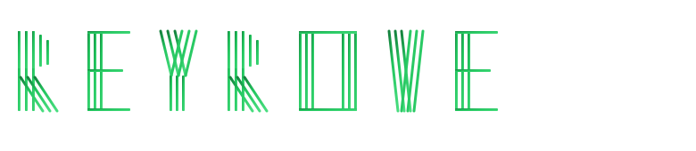

<div align="center">

  

  <br><br>

  <h3>Textile engineer, creative coder & generative designer.</h3>
  
  <p>I build visual systems, digital tools and computational experiments where material thinking meets code.</p>

  <p>
    <a href="https://reyrove.github.io/"></a>
    <a href="https://x.com/reyrove"></a>
    <a href="https://www.instagram.com/rey._.rove/"></a>
    <a href="https://objkt.com/users/tz1RXsijmPeeF1kPyrhd8Hkm2RskJAeU3si5/"></a>
  </p>

  <br>

  

</div>

<br>

---

## 🌿 The Practice

I started with **fibers**. Then I started asking what happens when fibers become **algorithms**. 

My work moves between textile engineering, mathematics, creative coding, generative art, and AI. I am interested in the hidden structures behind things: rhythm, repetition, tension, geometry, texture, and systems. 

Code becomes a kind of loom — a way to turn rules into forms, materials into experiences, and experiments into visual language.

---

## 🛠️ Selected Work

| 🧵 **Tools** | 🌀 **Generative Art** | 🤖 **AI Systems** |
| :---: | :---: | :---: |
| Textile Calculators<br>VS Code Themes<br>Quote Generators | Girih & Fourier Studies<br>Cellular Automata<br>ASCII Body Series | Sparrow Hawk AI<br>Textile Narrators<br>CodeArt Environments |
| 🔬 **Scientific Computing** | 🕹️ **Digital Experiences** | 🖼️ **On-Chain** |
| LAMMPS Simulations<br>Fortran Experiments<br>Molecular Dynamics | Interactive Games<br>Webbooks<br>AI Lounges | Tezos / OBJKT<br>Generative Collections<br>Digital Artifacts |

---

## 💻 The Codebase

This repository holds the source code for my personal portfolio. It is a fully static, single-page site built from scratch without heavy frameworks.

*   **Architecture:** Vanilla HTML5, CSS3, and JavaScript (ES5-compatible).
*   **Design System:** Custom CSS properties, fluid typography (`clamp()`), and grid/flexbox layouts. Dark, gold-on-charcoal palette.
*   **Data-Driven:** Projects are rendered dynamically from a single `PROJECTS` array in `script.js`, keeping the UI, filters, and JSON-LD SEO data perfectly in sync.
*   **Accessibility:** Full `prefers-reduced-motion` support, screen-reader friendly filters, skip links, and keyboard-navigable mobile menus.

<details>
  <summary><strong>📁 Click to view Project Structure</strong></summary>
  <br>

```text
.
├── index.html          # Page markup, SEO, Open Graph, JSON-LD
├── styles.css          # Design tokens, layouts, animations
├── script.js           # Project data, rendering, filters, nav
├── Reyrove.png         # Hero image
├── Reyrove-og.png      # Social sharing image (1200x630)
├── logo.svg            # Woven SVG logotype
└── images/
    ├── work/           # Project card images
    └── tutorials/      # Tutorial thumbnails
```
</details>

---

<div align="center">

  ### 👩🏻‍💻 Let's Connect

  For collaborations, creative technology, computational textiles, generative design, and experimental software.

  <br>

  <a href="mailto:reyhanehdaneshdoost@gmail.com">
    
  </a>
  <a href="https://www.linkedin.com/in/reyhaneh-daneshdoost-730481160/">
    
  </a>
  <a href="https://medium.com/@reyhanehdaneshdoost">
    
  </a>

  <br><br>

  <sub>© 2026 Reyhaneh Daneshdoost (Reyrove). All rights reserved.</sub><br>
  <sub>Reyrove® is a trademark of Reyhaneh Daneshdoost.</sub>

</div>
