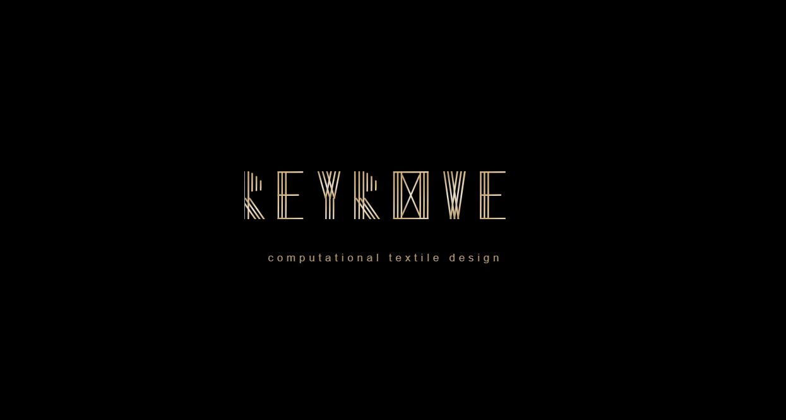

 <p align="center">
  <a href="https://reyrove.github.io/">
    
  </a>
</p>

<h1 align="center">REYROVE</h1>

<p align="center">
  <strong>FROM FIBERS TO FUNCTIONS.</strong>
  <br />
  Textile Engineer · Creative Coder · Generative Designer
  <br /><br />
  <a href="https://reyrove.github.io/">Portfolio</a> ·
  <a href="https://github.com/reyrove?tab=repositories">Projects</a> ·
  <a href="https://objkt.com/users/tz1RXsijmPeeF1kPyrhd8Hkm2RskJAeU3si5/">Collect Art</a> ·
  <a href="mailto:reyhanehdaneshdoost@gmail.com">Contact</a>
</p>

<p align="center">
  
  
  
</p>

---

### ✳ Welcome to my little corner of the internet.

I'm **Reyhaneh Daneshdoost**, known as **Reyrove** — a textile engineer who wandered into code and decided that algorithms could be looms, pixels could be fibers, and mathematics could become art.

My work lives somewhere between the physical and the digital: generative compositions, computational textile patterns, creative software, AI experiments, and scientific computing.

I care about how things work just as much as how they look. I like systems with structure, visuals with personality, and ideas that refuse to stay in one discipline.

**I don't just write code. I use it to build visual languages.**

---

### ⌘ The creative system

```text
                  R E Y R O V E
              ─────────────────────
                 FROM FIBERS
                 TO FUNCTIONS
              ─────────────────────

                MATERIAL THINKING
                        │
                        ▼
                   MATHEMATICS
                        │
                        ▼
                   CREATIVE CODE
                        │
              ┌─────────┼─────────┐
              ▼         ▼         ▼
          GENERATIVE    AI     SIMULATION
             ART      SYSTEMS   & SCIENCE
              │         │         │
              └─────────┼─────────┘
                        ▼
                 NEW VISUAL WORLDS
```

### ◈ What I'm weaving

<table>
  <tr>
    <td width="50%" valign="top">
      <h3>01 / Generative Art</h3>
      Algorithmic compositions, computational aesthetics, geometric structures, procedural visuals, and digital artworks built with code.
      <br /><br />
      <a href="https://objkt.com/users/tz1RXsijmPeeF1kPyrhd8Hkm2RskJAeU3si5/">Explore my collected works ↗</a>
    </td>
    <td width="50%" valign="top">
      <h3>02 / Computational Textiles</h3>
      Textile logic translated into algorithms: repetition, symmetry, interlacing, ornament, material-inspired structures, and generative surface design.
      <br /><br />
      <a href="https://reyrove.github.io/">Explore the portfolio ↗</a>
    </td>
  </tr>
  <tr>
    <td width="50%" valign="top">
      <h3>03 / Creative Technology & AI</h3>
      Experimental web applications, interactive visual tools, AI-powered creative systems, and interfaces where technology meets imagination.
      <br /><br />
      <a href="https://github.com/reyrove?tab=repositories">Explore the repositories ↗</a>
    </td>
    <td width="50%" valign="top">
      <h3>04 / Scientific Computing</h3>
      Programming and computational exploration inspired by materials science, molecular dynamics, simulation, mathematics, and technical visualization.
      <br /><br />
      <a href="https://github.com/reyrove?tab=repositories">Explore the code ↗</a>
    </td>
  </tr>
</table>

---

### ⌘ Selected experiments

<p align="center">
  <a href="https://reyrove.github.io/Matrix-Rain-Generative-Art/">
    
  </a>
  <a href="https://sparrow-hawk-code-art-generator.vercel.app/">
    
  </a>
  <a href="https://reyrove.github.io/javascript-notes-in-english/">
    
  </a>
  <a href="https://reyrove.github.io/HTML-Basics/">
    
  </a>
  <a href="https://reyrove.github.io/CSS-Fundamentals/">
    
  </a>
</p>

These projects represent different sides of my practice, from code-generated visual experiments to educational resources and interactive web experiences.

**More experiments live in the repositories:** [github.com/reyrove](https://github.com/reyrove?tab=repositories)

---

### ⌘ The tools behind the thread

<p align="center">
  
  
  
  
  
  
  
</p>

My approach is interdisciplinary. I choose tools based on the problem, whether I'm generating a visual composition, building an interface, exploring a computational model, or documenting a scientific idea.

**The stack is a toolkit, not a personality.**

---

### ⌘ Learn with me

I believe creative technology becomes more interesting when knowledge is shared.

I create educational content and practical notes covering programming, scientific tools, and digital craft, with resources in both English and Farsi.

- **[JavaScript — English notes](https://reyrove.github.io/javascript-notes-in-english/)**
- **[JavaScript — Farsi notes](https://reyrove.github.io/javascript-notes-in-farsi/)**
- **[HTML fundamentals](https://reyrove.github.io/HTML-Basics/)**
- **[CSS fundamentals](https://reyrove.github.io/CSS-Fundamentals/)**
- **[Fortran tutorials](https://www.youtube.com/watch?v=cyThxBP_I1I&list=PLzPYCB_3Ed9f_8IZq943sm71hR5bJWLgq)**
- **[LaTeX tutorials](https://www.youtube.com/watch?v=l7GZEXO_D_E&list=PLzPYCB_3Ed9d2lL-fIn6mnob0QtjaTGdp)**
- **[All tutorials and resources](https://reyrove.github.io/)**

Learn something. Break something. Build something better.

---

### ⌘ Beyond the screen

My work also extends beyond repositories and browser windows.

- **Print:** Featured in [Visual Art Journal — Issue 31](https://visualartjournal.com/2025/07/09/issue-31-july-2025/).
- **Writing:** Essays and experiments on [Medium](https://medium.com/@reyhanehdaneshdoost).
- **Digital art:** Selected works available on [OBJKT](https://objkt.com/users/tz1RXsijmPeeF1kPyrhd8Hkm2RskJAeU3si5/).
- **Portfolio:** The complete creative practice at [reyrove.github.io](https://reyrove.github.io/).

---

### ⌘ The philosophy

> The same curiosity that made me study how threads twist is now making me study how systems think.

I believe the most interesting ideas often emerge at the intersections: engineering and aesthetics, mathematics and intuition, physical materials and digital processes.

My goal is not to make technology look artistic as an afterthought. It is to explore what becomes possible when **engineering itself becomes part of the creative language**.

---

### ⌘ Let's make something strange.

I'm open to thoughtful collaborations involving:

- Generative art and creative coding
- Computational textiles and generative surface design
- Creative software, interactive experiences, and AI systems
- Scientific visualization and computational experiments
- Educational projects and interdisciplinary research

Have an interesting problem, a strange idea, or a project that doesn't fit neatly into one box? That's a good place to start.

<p align="center">
  <a href="mailto:reyhanehdaneshdoost@gmail.com">
    
  </a>
  <a href="https://reyrove.github.io/">
    
  </a>
</p>

<p align="center">
  <a href="https://github.com/reyrove">GitHub</a> ·
  <a href="https://x.com/reyrove">X</a> ·
  <a href="https://www.instagram.com/rey._.rove/">Instagram</a> ·
  <a href="https://www.youtube.com/c/freyjafa">YouTube</a> ·
  <a href="https://www.linkedin.com/in/reyhaneh-daneshdoost-730481160/">LinkedIn</a>
</p>

<p align="center">
  <sub>REYROVE · FROM FIBERS TO FUNCTIONS · © 2026 REYHANEH DANESHDOOST</sub>
  <br />
  <sub>Built with curiosity. Woven with code. Always a work in progress.</sub>
</p>
